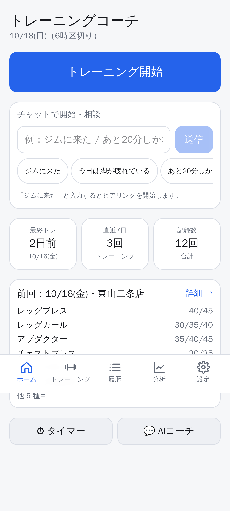
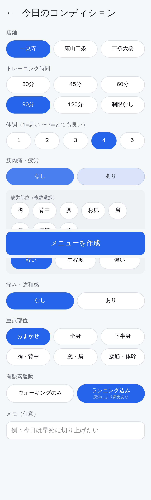
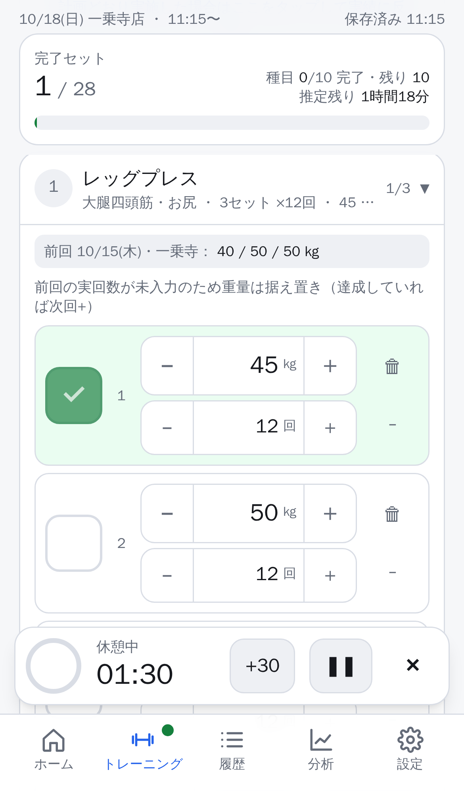
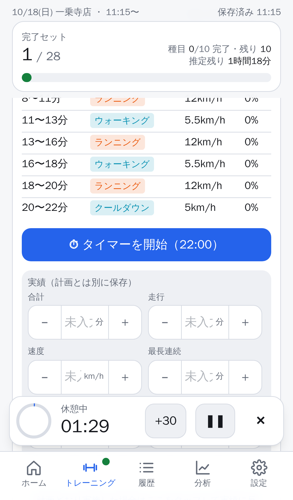
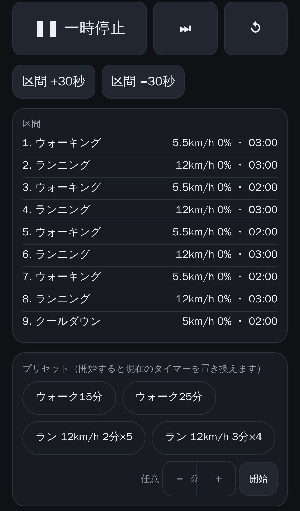
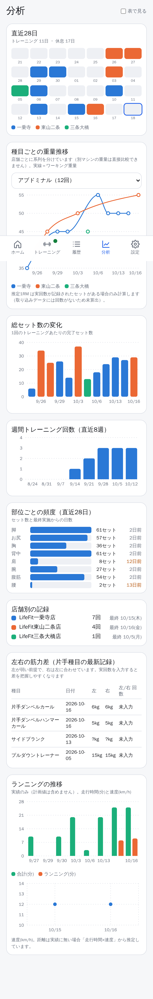

# トレーニングコーチ（トレーニング管理アプリ）

ジムでのトレーニングを、体調・疲労・時間・過去の実績からメニュー自動作成し、トレーニング中の記録・進捗管理・有酸素タイマー・成長分析まで行う PWA（ホーム画面に追加して使う Web アプリ）です。主な利用端末は iPhone を想定しています。

ChatGPT 上で運用していたパーソナルトレーニング支援を、独立したアプリとして実装したものです。

## 主な機能

| 機能 | 概要 |
|---|---|
| トレーニング開始ヒアリング | 店舗 / 時間 / 体調 / 筋肉痛・疲労（部位・強さ） / 痛み / 重点部位 / 有酸素（なし・ウォーキング・ランニング）を選択式で確認。前回値を初期値にし、変更可能。メモに「次から〇〇」と書くと今後の希望として保存 |
| はじめてのヒアリング | 初めて使う人は、パスワード入力・「はじめに」（名前と共有だけ）の直後に表示（スキップ可。以前から使っていてまだ答えていない人は初めてのトレーニング開始時）。経験（初期選択なし。選ばなければ経験による補正はしない）・目標（複数）・左右差・時間・きつさの好み・器具（マシン/ダンベル）・有酸素・多めに/控えめにしたい部位・やりたい/やりたくない種目・普段から気をつけたい痛み・自由記述の希望を質問（スキップ可）。体格の初期値は20歳・体重は男性65kg／女性55kg。2ページ目で「これまでに行っていたトレーニング種目」を種目一覧（全件）から選び（一覧の上の「＋ 種目を追加」で一覧に無い標準の種目を戻したり、新しく作ったりして選べる）、分かれば重量・回数を入力（無い人は2ページ目だけスキップ可）。選んだ種目は自動作成で選ばれやすくなり（自動作成の枠に無い種目も候補になる）、アプリにまだ記録が無いときは入力した重量の約9割から始める。答えは「メニューの希望」として毎回のメニュー作成に反映 |
| メニューの希望 | やりたくない種目は自動作成で選ばず同じ枠の別種目に、控えたい部位は減らし、はじめての人は種目数・セット数を抑えてマシン優先、軽め希望は回数多め・セット少なめ、追い込み希望は主要種目のセットを増やす、有酸素なしはその時間を筋トレに回す、普段の痛みは毎回除外判定に使う。作成時の要約に「希望を反映：…」と表示。設定画面の一番上「ヒアリング結果（メニューの希望）」で全項目を確認でき、「ヒアリング結果を編集する」から変更できる。伝えた希望の履歴も残る |
| トレーニングを調整（ホーム） | 選択肢から選ぶ方式（自由入力なし）。「久しぶりのトレーニング（1〜2週間／2〜4週間／1〜2か月／2か月以上）」を選ぶと次に作るメニューを軽めに、「今後の希望を変える」でヒアリング結果の編集へ |
| 自分でメニューを入力 | ホームの「メニューを自分で入力して記録」（またはヒアリング画面の「メニューを作らず自分で入力する」）から、店舗を選んで空のトレーニングを開始。「＋ 種目を追加」「＋ 有酸素を追加（トレッドミル／バイク）」で自由に組み立てて記録できる。過去の日付は保存後に履歴の「編集」で変更。種目を追加すると前回の記録と重量の進め方から重量・回数が入る。自分で入力した回数がそのまま目標になる。自分で組んだメニュー（直近8週間・最大6回）でよく行う種目は自動作成でも選ばれやすくなり（自動作成の枠に無い種目も候補になる）、並び順も自分のメニューに合わせる |
| 有酸素を押し付けない | ヒアリングの有酸素の初期値は「なし」。「ウォームアップのバイク：使う／使わない」も聞く（任意）。答えていなければ、その日に有酸素「なし」を選んだ人と、直近の記録（2回以上）でバイクを一度も行っていない人にはバイクを入れず、その分を筋トレに回す。開始前の質問の有酸素の初期値は、前回の選択 → ヒアリングの答え → 記録（走っていればランニング、歩いていればウォーキング）→ なし。トレッドミルを一度も行っていない人は「なし」から（選び直せば入る） |
| 記録から好みを学ぶ | おすすめを押し付けず、直近8週間・最大8回の記録（自動作成のメニューも含む。実際にセットを終えた種目・完了した有酸素だけ）から好みを学ぶ。よく行う種目は選ばれやすく（自分で入力したメニューの種目は特に）、並び順は「AとBを両方行った日のうちAが先だった回数」の多数決で決める（1回だけ順番が違った日に引きずられない）。行ったことのない種目は器具の種類（ダンベル→マシン など）の順に合わせて置く。セット数はその種目の直近3回の中央値（記録が無ければ標準値）。バイク・トレッドミルは、筋トレの前／途中／後のどこで行っていたかの多数決で置く。ダンベル優先・定期的に入れたい種目などの設定は学んだ好みより優先 |
| ルールベースのメニュー作成 | 履歴・経過日数・疲労・体調・店舗の器具・時間・前回重量から種目/セット/重量/回数/休憩を提案。別店舗の重量は「参考値」として扱い、実回数が未報告なら達成とみなさず据え置き |
| 重量の進め方 | 予定したセットを**すべて**目標回数で終えたときだけ前に進める（途中でやめた・届かなかったときは据え置き、2回続けて届かなければ約10%下げる）。初心者は重量を1段階ずつ、中級者以上・軽め希望は回数を上限まで増やしてから重量を上げる。新しい重量でこなせる回数を前回の結果から推定し、届きそうにないときは先に回数を増やす（刻みが大きすぎる器具では、上限の回数を3回続けて達成するまで上げない）。上級者・50歳以上・軽め希望は続けて達成してから上げる。体重・性別・年齢・経験から初めての種目の重量の目安を出す。種目は 下半身の複合 / 上半身の複合 / 単関節 / 体幹 に分けて上げ幅と回数の範囲を決める。前回より重い重量・多い回数のセットには注意書きを表示。経験×性別×体重×年齢×きつさの好み（144人）× 7種目 × 刻み2通り = 2016 通りを 24 回ずつシミュレーションし、重量の伸びが本当の筋力の伸びに沿うこと・重さがその人の力に合っていることをテストで確認 |
| 重量の刻み | 店舗・器具ごとに何kgずつ重量を変えられるかを設定（設定 → 店舗の器具、またはトレーニング中の「フォーム・メモ」）。メニューの重量・± ボタン・下げるときの丸めに使う |
| 久しぶりのトレーニング | 前回から2週間以上空いたとき、またはチャット・当日のメモで「久しぶり」「2週間ぶり」「1か月休んでた」などと伝えたときは、空いた期間に応じて重量を約10〜35%下げ（4週間以上ならセット数も減らす）、その日は重量・回数を上げない。トレーニング中に伝えると、まだ始めていない種目の重量とセット数を下げる |
| メインのトレーニング UI | 種目カード（折りたたみ / フォーカス）、大きな完了チェック、重量・回数の素早い編集、セット追加・削除（完了済みは確認 + 元に戻す）、未実施セットの除外、完了チェックで「目標どおり実施」として記録（届かなかったときは回数を実際の回数に直してからチェックすると「未達成」として記録。次回の重量の判断に使う）、片手種目の左右別記録、フォームの説明とメモは「フォーム・メモ」を押したときだけ表示、見出しの長押しドラッグで種目・有酸素の並べ替え（Notion の行の移動のような操作。有酸素を種目の間へ動かすことも可能。画面の端で止めると自動スクロール）、バイク・トレッドミルも削除可能、進捗バー（セット数・種目数・残り種目・推定残り時間） |
| 自動保存・再開 | 変更のたびに IndexedDB に保存。アプリを閉じても途中から再開。終了・保存後も履歴から修正可能。画面上部と下部の「キャンセル」でその日のトレーニングを破棄できる |
| 有酸素管理 | バイク / トレッドミルの区間表（時間・運動・速度・傾斜）。ランニングは前回実績から連続走行時間を段階的に延長（速度と時間を同時に大きく上げない）。計画と実績を区別して保存 |
| タイマー | 「インターバル」（運動・休憩・回数・準備を自由に設定）、「タイマー」（分・秒を設定する通常のタイマー）、バイク、トレッドミルの4種類。バイク・トレッドミルは作られた区間をそのまま使え、「時間・負荷を変更」で区間ごとの時間とレベル（バイク）・速度と傾斜（トレッドミル）を自分で変えてセットできる（メニューの有酸素と紐づくときはメニューの計画にも反映）。プリセットや設定を選ぶとセットされるだけで、スタートは自分で押す。スタートしたタイマーは履歴に残り、履歴をタップするとすぐ呼び出せる（名前も付けられる）。一時停止 / 再開 / リセット / 次区間へ / ±30秒。音・振動（対応端末）・画面消灯防止。スリープ後も開始時刻から正しく復元。セット完了後の休憩タイマーはトレーニング画面に自動で表示（±10秒で調整。時間は設定画面で「種目ごと」または30秒〜3分から選べる。各種目の最終セットの後は表示しない） |
| 履歴・分析 | 午前6時区切り（Asia/Tokyo）のトレーニング日。種目ごとの重量推移（店舗別系列）、総セット数、店舗別、ランニング推移、週間・月間、休息日カレンダー。JSON / CSV エクスポート、JSON インポート |
| 店舗の追加 | 標準の LifeFit 3店舗に加えて、設定画面で店舗を追加・名前変更・削除できる。追加した店舗の器具は「すべて未確認」か、既存店舗の設定をコピーして始める。削除しても記録は残り、記録には店舗名が保存される |
| 店舗別器具管理 | 店舗ごとに「ある / 未確認 / ない」を編集。「ない」にすると次回以降のメニューから自動除外 |
| トレーニングを調整（トレーニング中） | 選択肢から選ぶ方式（自由入力なし）。「残り時間が少ない（10〜45分）」「疲れている部位がある（部位を選ぶ）」「マシンが使えない（種目を選ぶと同じ部位の種目に置き換え）」「重量を上げてもいい？」「ランニングをやめてウォーキングにする」「今日は有酸素をやめる」「久しぶりのトレーニングだった」「今後この種目は外したい」。提案は「予定」にだけ反映され、実績は変更しない |

| 初回設定（はじめに） | 表示名・目標・左右差・ランニング開始速度・定期的に入れたい種目・ダンベル優先を設定。全員が空の状態から始まる |
| 作成者の記録の復元 | 作成者の過去の記録（2026-09-20〜10-16、12回分）はサーバー側にだけ置き、復元コード（`OWNER_RESTORE_CODE`）を知っている本人だけが `/restore` から取り込める。他の利用者には表示されない |
| 種目一覧 | 設定の「種目一覧」で標準・自作のすべての種目を確認でき、各種目の × で削除できる（トレーニング中の「種目を追加」からも ×）。削除した標準の種目は自動作成と種目の追加に出なくなり、「削除した標準の種目」からいつでも元に戻せる。過去の記録は種目名ごと残る |
| 自分の種目 | カタログに無い種目を作成・編集・削除できる（種目名・記録の仕方〔重量×回数／回数のみ／時間〕・器具・鍛える部位・片手片脚・セット数・目標回数・重量の刻み・休憩・フォームのメモ）。トレーニング中の「種目を追加」から作ってそのまま追加することも可能。「メニューの自動作成に含める」をオンにすると自動作成の候補になる。削除しても過去の記録には種目名が残り、共有先にも名前つきで表示される |
| 標準の種目一覧 | LifeFit 一乗寺店・東山二条店の器具の種目（器具ごとに1種目）、ベンチプレス、ダンベルの代表的な5種目（ダンベルベンチプレス・ワンハンドダンベルロウ・ダンベルショルダープレス・サイドレイズ・ゴブレットスクワット）、作成者が行っていた種目、今後追加する予定だった種目にしぼる。それ以外（デッドリフト・ハックスクワット・ダンベルフライなど）は「一覧に入っていない標準の種目」から一覧に加えられる |
| ダンベル種目 | ダンベルベンチプレス・インクラインダンベルプレス・フライ・ワンハンドロウ・ショルダープレス・サイドレイズ・リアレイズ・シュラッグ・ゴブレットスクワット・ランジ・ルーマニアンデッドリフト・キックバック・フレンチプレス。通常はマシン優先で、マシンが無い店舗や「ダンベル優先」の人に提案 |
| バーベル・プレート式の種目 | LifeFit 公式の店舗ページのマシンリスト（一乗寺店・三条大橋店、2026-10-20 確認）の器具を店舗の器具に登録し、ベンチプレス・バーベルスクワット・デッドリフト・ベントオーバーロウ（パワーラック）、スミスマシンのベンチプレス・スクワット・ショルダープレス、EZバーカール、プレートチェストプレス・コンバージングチェストプレス・プレートショルダープレス・プレートラットプルダウン・45度レッグプレス・ハックスクワット・ロータリートーソー・チンニング・ディップス・レッグレイズ（チェア）・デクラインシットアップを標準の種目にした。重量はバーやプレートを含めた合計で記録。メニューの自動作成の枠には入れず、種目の追加や自分で組んだメニューで使う（よく使うと自動作成でも選ばれやすくなる） |
| トレーニング時間 | セットの完了時刻から、マシン・ダンベル・自重・有酸素の時間と合計を自動計算。終了時と履歴で修正可能。共有している人は時間も「みんな」に表示（直近7日の合計も） |
| 人ごとの目標 | 設定画面でいつでも変更可能。メニュー作成に反映（有酸素の長さ、筋力重視の回数、優先部位、お気に入り種目、片手種目の左右の進め方） |
| みんなの記録（共有） | 各自が共有のオン・オフを選択。共有するのは「誰が・いつ・どこで・どれくらい」（表示名・日付・店舗・時間の内訳・種目数とセット数・有酸素の分数）だけで、種目名・重量・回数・体調・痛み・メモは共有しない。「みんな」タブでは直近2週間の表（行＝人、列＝日、色＝店舗、濃さ＝量）と最近のトレーニング（量の横棒）、各人のページでは直近28日のカレンダーと回ごとの量を表示。以前の形式で送られていた詳細はサーバーで要約だけにして返し、各端末が次に開いたときに要約だけで送り直す。オフにするとサーバー上の記録は削除。作成者は「みんな」タブの「アカウントを整理する（作成者のみ）」で復元コード（`OWNER_RESTORE_CODE`）を入力すると、不要なアカウントを削除できる（自分のアカウントは対象外） |

## 技術スタック

- Next.js 16（App Router, Turbopack）/ React 19 / TypeScript
- Tailwind CSS v4（ダークモードは `data-theme` 属性 + システム設定）
- Dexie（IndexedDB）… ローカル保存。全レコードに `id` / `updatedAt` を持たせ、将来のクラウド同期（差分転送）に備えた設計
- Recharts … 分析グラフ
- Vitest（単体）/ Playwright（E2E, iPhone 14 ビューポート）

## セットアップ

```bash
cd training-app
npm install
npm run dev          # http://localhost:3000
```

本番ビルドと起動:

```bash
npm run build
npm start            # http://localhost:3000
```

> Service Worker（オフライン用）は本番ビルド（`npm run build && npm start`）でのみ登録されます。開発サーバーでは登録しません。

### iPhone での利用（ホーム画面に追加）

1. 同じ Wi-Fi 上の PC で `npm run build && npm start -- -H 0.0.0.0` を実行し、iPhone の Safari で `http://<PCのIPアドレス>:3000` を開く
   - PWA として「ホーム画面に追加」した後の standalone 起動や Wake Lock を確実に使うには **HTTPS** が必要です。外部公開する場合は Vercel 等へのデプロイ（下記）を推奨します。
2. Safari の共有ボタン → **ホーム画面に追加**
3. ホーム画面のアイコンから起動（アプリのように全画面で動作します）

## 使い方

1. **ホーム** → 「トレーニング開始」（またはチャット欄に「ジムに来た」）
2. **今日のコンディション** を選択 → 「メニューを作成」
3. **トレーニング画面**
   - 種目カードのヘッダーをタップで折りたたみ。「この種目に集中」で 1 種目だけ大きく表示
   - 各セット：✓ で完了（休憩タイマーが自動で出ます）、−/＋ または直接入力で重量・回数を編集、🗑 で削除、− で「未実施として除外」
   - 「実回数」ボタンで実際の回数と体感（楽 / 適正 / きつい）を入力。実回数を入れておくと次回の重量提案と推定 1RM に反映されます
   - 「フォーム」でフォーム・シート設定・注意点を表示
   - 有酸素カードは順番が来るまで折りたたみ（最初の未完了種目と、その前のウォームアップだけ開く）。「時間・負荷を変更」で区間ごとの時間・負荷を変えられ、「タイマーを開始」で区間タイマーへ。「計画どおり完了にする」で計画の内容がそのまま実績になり、違ったときだけ「実績を入力」で直す。終了後「計画どおり実施 → 実績に反映」。手入力する実績はトレッドミルが合計・走行時間・速度、バイクが合計時間のみ
   - 「トレーニングを調整」で「残り時間が少ない」「マシンが使えない」などを選ぶとメニューを組み直す
   - 「トレーニングを終了・保存」→ 未完了セットは未実施として除外されます（履歴から「修正する」で変更可）
4. **履歴** で過去の記録を確認・修正。**分析** でグラフ。**設定** で店舗の器具・除外種目・テーマ・エクスポート。

### 1 日の区切り

トレーニング日は **午前 6 時〜翌午前 6 時（Asia/Tokyo）** です。例：10/14 01:00 のトレーニングは 10/13 として記録されます（`src/lib/date/trainingDay.ts`）。

### タイマーの制約（iOS）

- iPhone の Safari / ホーム画面アプリでは、**画面がスリープしたりアプリが裏に回ると、音や振動は鳴りません**（iOS の制約。バックグラウンド通知は保証できません）。
- 対策として「画面を消灯しない」（Screen Wake Lock, iOS 16.4+ / HTTPS が必要）を既定で有効にしています。トレッドミルのホルダーに置いて画面を表示したままにしてください。
- 音は最初のタップ（開始ボタン）で有効化されます。iPhone のサイレントスイッチが ON だと Web Audio の音は鳴らないことがあります。
- スリープしても、タイマーは「開始時刻」基準で計算しているため、再表示時に正しい経過時間・区間に復元されます。
- iOS Safari は振動 API（`navigator.vibrate`）に非対応です（Android Chrome では動作）。

## データ

- すべてこの端末の IndexedDB（`training-coach`）に保存されます。共有をオンにした場合のみ、完了した記録が共有サーバーにも送られます。
- **設定 → データ** から JSON（全件）/ CSV（セット単位・有酸素）をエクスポートできます。機種変更時は JSON をエクスポート → 新端末でインポートしてください。
- iOS では長期間（7日以上）サイトを開かないとブラウザがデータを削除することがあります。ホーム画面に追加した PWA はこの対象外ですが、定期的なエクスポートを推奨します。
- 共有をオンにすると、完了した記録の写しが共有サーバーにも保存されます（下記「複数人での利用と記録共有」）。

## テスト

```bash
npm run typecheck     # tsc
npm run lint          # eslint
npm test              # Vitest（日付境界・プランナー・目標・タイマー・編集・意図解析・分析・エクスポート・共有）
npm run test:e2e      # Playwright（本番ビルド後に実行。npm run build が必要）
```

E2E は iPhone 14 のビューポートで、初回設定、店舗の追加と削除、3人での記録共有（共有した人だけ表示・オフで削除・保存時の自動送信）、開始→メニュー作成→セット追加/削除/重量編集→再読み込みで復元→保存→履歴、チャット開始と「あと20分」短縮、タイマーの一時停止/再開/復元、器具の除外、PWA（manifest / Service Worker）、ダークモードを確認します。

このリポジトリの環境では Chromium が `/opt/pw-browsers/chromium` にあるため `playwright.config.ts` でそのパスを使用しています。別環境では `npx playwright install chromium` 後に `PW_CHROMIUM=` を外すか環境変数で上書きしてください。

## ディレクトリ構成

```
src/
  app/                 ページ（/ , /start, /workout, /history, /analytics, /settings, /timer/[machine], /login, /welcome, /community, /api/share/*）
  components/          UI（workout, timer, history, analytics, settings, coach, ui）
  lib/
    types.ts           ドメインモデル（予定と実績を分離）
    catalog/           種目・器具・店舗・筋群カタログ、店舗別器具の初期値
    date/              6時区切り・Asia/Tokyo の日付計算
    db/                Dexie（IndexedDB）とリポジトリ
    seed/              既存履歴の正規化データ
    planner/           ルールベースのメニュー生成・有酸素プラン・履歴分析ヘルパー
    workout/           セット編集・進捗・終了処理（純粋関数）
    timer/             タイムスタンプ基準のタイマーエンジン・通知
    coach/             意図解析（ルールベース）・構造化パッチの適用
    share/             記録共有（検証スキーマ・保存先アダプタ・サーバーロジック・クライアント同期）
    goals.ts           目標の初期値（新しい利用者 / 作成者）
    analytics/         集計
    export.ts          JSON / CSV
public/sw.js           Service Worker（アプリシェルのキャッシュ）
e2e/                   Playwright
scripts/               アイコン生成・スクリーンショット
```

## 設計上の方針（仕様からの要点）

- **予定と実績の厳密な区別**：`WorkoutSet.weight/reps` は目標、`actualReps/actualSeconds` は実績。実績が未入力のセットは「目標達成」とみなしません。ルールエンジンは `completed` なセットの実績を変更しません（`src/lib/coach/applyPatch.ts`）。
- **別店舗・別マシンの重量**：同一負荷とみなさず、参考値として 1 段階軽くし、カードに「参考値」ラベルを表示。グラフは店舗ごとに系列を分けます。
- **器具の有無を推測で確定しない**：利用実績のある器具は「ある」、不明は「未確認」として表示。「ない」にすると次回以降除外。追加した店舗の器具は最初はすべて「未確認」です。
- **長時間でもセット数を増やしすぎない**：制限なしでも最大 12 種目・3 セットまで。筋トレと有酸素の両立を優先。
- **バードドッグ**はカタログに含めていません。**片手ダンベルハンマーカール**は直近 2 回入っていなければ優先度を上げます。

## 外出先（別の Wi-Fi / モバイル回線）から使う：無料で公開する

自宅 PC で動かす方法は同じ Wi-Fi でしか使えません。どこからでも使うには、無料ホスティングに公開します。**Vercel の Hobby プラン（個人・非商用は無料）**が最も簡単です。

### 1. アクセス保護を有効にする（推奨）

公開 URL は誰でも開けるため、共有パスワードで保護します。環境変数 `APP_PASSWORD` を設定すると、全画面でパスワードが必要になります（一度ログインすると端末ごとに 1 年間有効。Cookie にはハッシュのみ保存）。記録データ自体は各端末の IndexedDB にあり、サーバーには保存されません。

### 2. Vercel にデプロイする

1. [vercel.com](https://vercel.com) に GitHub アカウントでサインアップ（無料）
2. **Add New → Project** → この GitHub リポジトリ（`1took0/Yuto_Takeshige`）を Import
3. 設定画面で次を指定
   - **Root Directory**: `training-app`
   - **Framework Preset**: Next.js（自動検出）
   - **Environment Variables**:
     - `APP_PASSWORD` = 好きなパスワード（推奨。記録共有を使う場合は必須）
4. **Deploy** を押す。数分で `https://<プロジェクト名>.vercel.app` が発行されます
5. iPhone の Safari でその URL を開き、パスワードを入力 → 共有ボタン → **ホーム画面に追加**

HTTPS になるため、オフラインキャッシュ・画面消灯防止（Wake Lock）など PWA の全機能が有効になります。以後は GitHub の対象ブランチに push するたびに自動で再デプロイされます（Vercel の Production Branch 設定で、このアプリのブランチを指定してください）。

### 費用

| 項目 | 費用 |
|---|---|
| Vercel Hobby（個人利用） | 無料（帯域 100GB/月など十分な無料枠） |
| アプリ本体・データ保存 | 無料（データは端末内） |
| 記録共有（Upstash Redis Free） | 無料（任意） |

### 代替案

- **Cloudflare Workers / Pages**（無料枠あり）: `@opennextjs/cloudflare` を使えば Next.js をデプロイできますが、設定が増えます。
- **自宅 PC + Tailscale**（無料）: PC と iPhone に Tailscale を入れると、外出先から自宅 PC の `http://<Tailscale IP>:3000` に到達できます。ただし HTTP のため PWA のオフライン機能と Wake Lock は使えず、PC を常時起動しておく必要があります。

### ローカルで保護を試す

```bash
APP_PASSWORD=test1234 npm start
```

## 複数人での利用と記録共有

同じ URL を複数人で使えます。記録は各自の端末に保存され、共有をオンにした人の記録だけがサーバーにも送られ、「みんな」タブで全員に表示されます。

### 仕組み

- 初回起動時に各端末でプロフィール（ランダムな ID と秘密トークン）を作成します。サーバーにはトークンのハッシュのみ保存し、本人の端末以外からは記録を変更・削除できません。
- 共有されるのは表示名と、完了した記録の要約（日付・店舗・トレーニング時間の内訳・種目数とセット数・有酸素の分数）だけです。種目名・重量・回数・記録のメモ・ヒアリング内容（体調・疲労・痛み）は送りません。以前の版で詳細つきで送られた記録も、サーバーは要約だけを返し、各端末は次に開いたときに要約だけで送り直します。
- 作成者は「みんな」タブの「アカウントを整理する（作成者のみ）」で復元コードを入力すると、不要なアカウントを削除できます。
- 共有をオフにすると、その人のプロフィールと記録をサーバーから完全に削除します。
- 通信できないときは変更を保留し、次回起動時や再接続時に自動で送信します。
- 記録共有は**アクセス保護（APP_PASSWORD）が設定されているときだけ**有効になります。URL を知っているだけの第三者には記録が見えません。

### 共有の保存先を用意する（無料）

Vercel で公開している場合：

1. Vercel のプロジェクト画面 → **Storage**（または Marketplace）→ **Upstash for Redis** を選び、**Free** プランでデータベースを作成してプロジェクトに接続
2. 接続すると `KV_REST_API_URL` / `KV_REST_API_TOKEN`（または `UPSTASH_REDIS_REST_URL` / `UPSTASH_REDIS_REST_TOKEN`）が自動で環境変数に追加されます
3. `APP_PASSWORD` が設定されていることを確認して再デプロイ

Upstash の無料プランはクレジットカード不要で、データ容量 256MB です。数人〜十数人のトレーニング記録なら十分収まります。Free プランのままなら課金は発生しません。無料枠の上限を超えた場合は共有の読み書きが一時的に止まりますが、記録自体は各端末に残ります。有料プランへの切り替えは手動操作が必要なので、誤って課金されることはありません。最新の無料枠は [Upstash の料金ページ](https://upstash.com/pricing/redis) で確認してください。

自宅 PC で動かす場合は、ファイルに保存できます。

```bash
APP_PASSWORD=好きなパスワード SHARE_STORE=file npm start
```

### 作成者の記録の復元

作成者の過去の記録は、復元コードを知っている人だけが取り込めます。サーバーの環境変数 `OWNER_RESTORE_CODE` に好きなコードを設定し、作成者本人の端末で一度だけ、**設定 → データ →「復元コードで記録を取り込む」**（`https://<公開URL>/restore`）を開きます。

> iPhone では、ホーム画面に追加したアプリと Safari とでデータが共有されません。Safari で取り込んでからホーム画面に追加すると、ホーム画面版には記録がありません。**先にホーム画面に追加し、そのアプリの中で**ログイン・初回設定・復元を行ってください。

コードを入力すると12回分が取り込まれ、目標も作成者の設定になります（チェックを外せば目標はそのまま）。コードを知らない人には取り込めず、記録データは公開される JavaScript にも含まれません。

### 利用者を増やす手順

1. URL と APP_PASSWORD を伝える
2. 各自が iPhone の Safari で開いてパスワードを入力し、ホーム画面に追加
3. 「はじめに」で表示名と目標を設定。共有したい人は「記録を共有する」にチェック（あとから設定画面で切り替え可能）

## スクリーンショット（iPhone 14 サイズ）

| ホーム | ヒアリング | トレーニング中 |
|---|---|---|
|  |  |  |

| 有酸素の区間表 | トレッドミルタイマー（ダーク） | 分析 |
|---|---|---|
|  |  |  |
